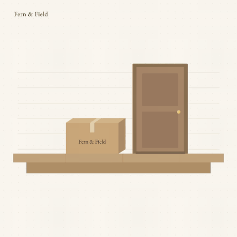
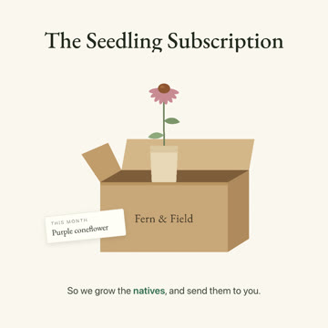

<a id="video-direction"></a>
<p align="center">
  <picture><source media="(prefers-color-scheme: dark)" srcset="docs/media/video-direction-wordmark-dark.png"></picture>
</p>

<p align="center">
A Claude Code plugin that gives AI-made brand videos a director, so they stop looking generic.
</p>

<p align="center">
     
</p>

<table>
  <tr>
    <td width="50%"><a href="examples/fern-and-field/video-work/seedling-subscription-film/"></a></td>
    <td width="50%"><a href="examples/fern-and-field/video-work/plug-to-porch/"></a></td>
  </tr>
  <tr>
    <td><sub><b>Launch Film</b> · 31s · voiceover and a scored bed</sub></td>
    <td><sub><b>Mechanism Explainer</b> · 28s · captions over a bed, no voice</sub></td>
  </tr>
</table>

<sub>Two videos for one fictional brand, Fern and Field, each directed end to end by the plugin from the same brand file. The second had to look different from the first because the brand's style ledger said so. The GIFs are silent previews; the MP4s with sound, and every stage behind them, live in <a href="examples/fern-and-field/">examples/fern-and-field</a>.</sub>

Install it with two commands inside Claude Code. In Claude Cowork, add it from the plugins screen instead.

```
/plugin marketplace add derrtaderr/video-direction-plugin
/plugin install video-direction@video-direction
```

You can one-shot-prompt a brand video in a minute, and it will look like every other
one-shot-prompted video, because nothing forced a look decision. This plugin is the
director's seat you skipped. It runs a staged studio process (treatment, style, boards,
styleframes, build, QC) with a gate at each stage, so the look, timing, and sound are
decisions on the record instead of the model's statistical average. It directs;
[HyperFrames](#prerequisites) renders.

**Motion is demanded, not hoped for.** Every beat names its camera move, entrance, state
change and transition from a motion vocabulary; a motion critic measures the composition
before it renders and fails it under the archetype's floor; and each new video has to reach
for moves the brand has not used in its last two. The result is videos that read as
designed rather than assembled.

## Behind the cut

Each frame below is a decision the process forced before the final render.

<table>
  <tr>
    <td width="25%"></td>
    <td width="25%"></td>
    <td width="25%"></td>
    <td width="25%"></td>
  </tr>
  <tr>
    <td><sub><b>Styleframe A, picked.</b> The hero frame is rendered two ways and judged against a reference film before anything moves.</sub></td>
    <td><sub><b>Styleframe B, rejected.</b> The title runs into the box flap, and the bloom would drift off the line the camera pulls back on.</sub></td>
    <td><sub><b>Caught in QC.</b> The stills pulled at every transition's midpoint showed two scenes stacked at half opacity, a muddy double exposure.</sub></td>
    <td><sub><b>Fixed.</b> The old scene now leaves before the new one arrives. Before either film could render, the motion critic failed this one once and the explainer twice.</sub></td>
  </tr>
</table>

The style ledger then pushed the second video away from the first on every axis they
share: captions instead of a voice, panels that hold while the content moves instead of a
traveling camera, and the accent tracing a path instead of marking a word. Read the ledger
at [`examples/fern-and-field/style-ledger.md`](examples/fern-and-field/style-ledger.md).

## Install

Run the two commands at the [top of this page](#video-direction) inside Claude Code, or add it from the plugins screen in Claude Cowork.

Working from a local clone instead? Point the first command at the folder:
`/plugin marketplace add /path/to/video-direction-plugin`

The install copies everything into your own Claude config, so it keeps working even
if you delete the downloaded folder. It runs entirely on your machine and your Claude
subscription.

## Your first video in 3 steps

1. **Run `/brand-init`.** A short taste-by-comparison interview — mostly A/B picks (world,
   type, accent, audio, delivery), about 15 minutes — writes your `motion-brand.md` and
   renders one proof styleframe in your new brand so you see "that's MY brand" before you
   make a real video. (Prefer to do it by hand? Copy `templates/motion-brand-template.md`
   to `motion-brand.md` and fill it in.) It is the source of truth for every video.
2. **Ask for a video** in plain language — "make a launch film for X," pointing at real
   content (a page, a README, a post). The `video-direction` skill runs treatment →
   style → boards → styleframes and presents a styleframe A/B pair.
3. **Pick A or B.** It builds, runs the critics, renders, and hands you the MP4 path
   plus a QC summary.

## Audio (optional)

Videos render **silent by default**, with a one-line note on the render telling you how to
score it. The plugin never blocks a render to go source a track, and never ships silence
by accident without saying so. Two ways to add sound:

- **Drop a track into the piece.** Put any audio file in the piece's
  `video-work/<slug>/composition/audio/` and it scores the render. No key, no account.
- **Generate sound locally, no key needed.** HyperFrames ships optional local models for
  voice (`npx hyperframes tts`, Kokoro) and background music (MusicGen). `npx hyperframes
  doctor` lists both; they light up once the local dependencies are installed. Free, and
  nothing leaves your machine.
- **Bring your own ElevenLabs key (the studio upgrade).** Set `ELEVENLABS_API_KEY` in your
  environment and the skill generates studio voiceover or scored music for you, masters it
  to broadcast loudness, and drops it into the piece before the render. It runs locally in
  your own session against your own key. The key is never bundled with this plugin, never
  read from a file, and never sent anywhere but ElevenLabs. No key set means this tier
  stays off and the free local path is the default. Any other provider works the manual
  way too, generate the track yourself and save it into `composition/audio/`.

The house rule — *no video ships silent by accident* — is taught, not enforced: your
`motion-brand.md` Audio section wins. If it permits silent, a silent render is correct.

Next: set your audio default in `/brand-init` (the Audio question), then ask for a video.

## Coming back / editing your brand

Once your `motion-brand.md` exists you don't re-run setup to make more videos — just ask
for one in plain language. The `video-direction` skill detects the brand file, skips
straight to the treatment, and reads your `style-ledger.md` (`/brand-init` writes it
beside the brand file; the skill appends a row per shipped video) so video 2 varies the
variant axes and never repeats video 1's look.

To change the brand itself, re-run `/brand-init`. With a brand file already present it
never silently overwrites: it offers a **targeted edit** (re-ask just one section —
constants, roster, selection, audio, or delivery) or a full **regenerate**, and regenerate
only proceeds after you type the word `regenerate` to confirm.

Next: ask for your next video, or run `/brand-init` and pick **edit** to adjust one section.

## Prerequisites

- **Claude Code** or **Claude Cowork**. It installs and runs in either, from the brand interview through a full rendered video, tested on each from a separate user account.
- **Node 22+**.
- **ffmpeg** (renders composite audio and video).
- **HyperFrames** — the rendering framework. Nothing to install ahead of time; it is
  fetched on demand via `npx hyperframes …`.

**Preflight:** run `npx hyperframes doctor` once before your first render. It checks
Chrome, ffmpeg, and Node and names the exact fix for anything missing. The first `npx`
call may pause ~30s while it fetches — that is normal, not a hang. If that very first
fetch errors instead (e.g. a transient npm `ETARGET`), just re-run the command — a
cold-cache flake, not a broken install.

With that green, run `/brand-init` to build your brand and make your first video.

## Running the tests

From the plugin root, `node --test 'skills/video-direction/scripts/**/*.test.mjs' 'tests/*.test.mjs'` runs the skill's scripts and the README contract.

## Status

Early, but the core loop works. The `video-direction` skill (the studio process) and
`/brand-init` (the taste-by-comparison brand interview, ending in a proof styleframe) both
run today. Next is a film that runs three different brands through the same process, side by side.

To start now, run `/brand-init`.
